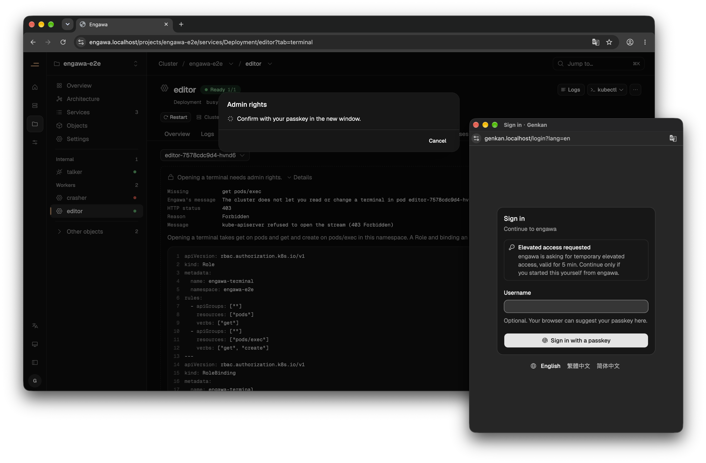
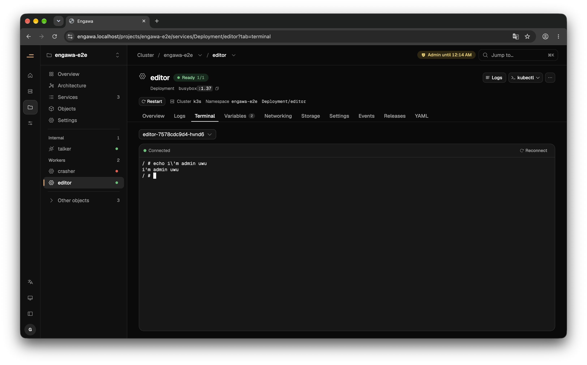

import TrustStructure from '../../../components/figures/TrustStructure.tsx';
import HotelKeycard from '../../../components/figures/HotelKeycard.tsx';
import LoginFlow from '../../../components/figures/LoginFlow.tsx';

After reading Zeabur's August incident report, I couldn't shake one question: should a PaaS be holding your secrets in the first place? 🤔

I've been exploring a different approach: give the platform no privileges of its own. Every action uses the current user's Kubernetes credentials, and kube-apiserver decides whether to allow it. Here's why I think that's worth trying, and how I've implemented it in Genkan and engawa.

## Why does a PaaS need your secrets?

You set `DATABASE_URL` in Vercel, Netlify, Render, or Railway, click Deploy, and a few dozen seconds later your service is up. But how does that value get into your container?

As a platform builder, the answer is uncomfortable: we have to know the value. Your application eventually needs the environment variable in plaintext, so some component on the platform has to handle that plaintext during build and startup. Even after its migration, Zeabur says it “only reads this data when building and deploying” [^1].

That means you're trusting the people who build and run the platform. The platform holds a highly privileged credential that can operate every customer's projects, then gives you access to a subset of those privileges. No matter how granular the permissions in the UI look, they all depend on that credential.

For an attacker, that's an attractive target. Why compromise customers one at a time when breaking into the platform gets you all of them?

## Has this actually happened?

Yes—repeatedly. Here are five incidents with different entry points and the same kind of payoff: secrets the platform was holding.

| Date | Platform | Entry point | Exposed data |
| --- | --- | --- | --- |
| 2026-08 | Zeabur | CVE in a user service → internal cluster network → unscoped Legacy API Key → AWS root key → maintenance task → primary database [^2] | Names and values of project environment variables |
| 2026-04 | Vercel | Compromised OAuth app at third-party AI tool Context.ai → employee’s Google Workspace → employee’s Vercel account [^3] | Environment variables not marked sensitive |
| 2022-12 | CircleCI | Malware on an engineer’s laptop stole an SSO session cookie that had passed 2FA [^4] | Customer environment variables, tokens, and keys; encryption keys were also extracted from a running process |
| 2022-04 | Heroku, Travis CI (via GitHub) | Stolen OAuth tokens issued to these two integrations [^5] | Private repositories at dozens of organizations; npm’s AWS keys were obtained this way |
| 2021-01 | Codecov | Tampered Bash Uploader [^6] | `env` output from CI environments |

### How did Zeabur’s August attack reach the database?

I initially read this as a database breach. Reading Zeabur's full incident report changed that picture: the database was the last stop in a much longer attack chain [^2]. Everything below comes from that report.

It started with NextChat v2.16.1 deployed by a customer. Its MCP feature had an insufficient authorization-check vulnerability (CVE-2026-7644), which the attacker used to execute code inside the container. The container ran on a shared cluster and could reach the routing cache over the internal network. That cache happened to contain Legacy API Keys. These keys had no scope restrictions and never expired. The attacker used a team administrator’s key to read the environment variables of an internal management service, where they found a long-lived AWS root key.

Next, the attacker took over the shared cluster in Tokyo. A scheduled maintenance task on that cluster had a private network path into production and overly privileged database credentials. Starting at 11:52 UTC, project environment variables were read out in batches. Early the next morning, Zeabur received its first report of API-key abuse [^2].

### What about Vercel?

This time the attacker did not even touch the database. According to the announcement, Context.ai, a third-party AI tool used by an employee, was compromised first. From there, the attacker gained access to that employee’s Google Workspace account, signed into their Vercel account, and listed and decrypted environment variables that were not marked sensitive [^3]. The announcement recommends sensitive environment variables so that “secret values are protected from being read in the future” [^3]. But the unmarked values in this incident had already been read.

### Isn't the answer to secure those entry points?

You have to, but the list never ends: application vulnerabilities, employee laptops, OAuth apps, tampered CI scripts. The way in changes. The destination doesn't: secrets the platform can read.

CircleCI encrypted its stored data, but the attacker also extracted the encryption keys from a running process [^4]. If the platform needs to decrypt a secret to use it, encryption at rest doesn't protect that secret once the platform is compromised. Codecov's `env` output [^6], CircleCI's customer secrets [^4], Zeabur's project environment variables [^2]—in each case, many customers were hit at once.

As platform builders, we patch the hole and wait for the next one. The secrets are still sitting in the same place.

## What is Zero Trust?

NIST SP 800-207 is straightforward: being on the internal network or using a company-owned machine does not automatically make you trustworthy. One of its principles states, “Network location alone does not imply trust” [^7]. Every access must be authenticated and authorized again, with only the privileges needed [^7]. Design on the assumption that the network is already compromised [^7].

I want to take that one step further: assume the PaaS control plane gets compromised, too. Under that assumption, the platform shouldn't hold credentials an attacker can just pick up and use. It shouldn't store long-lived credentials at all. Instead, every action should carry the current user's identity, with the authorization decision made elsewhere. NIST calls those roles the policy decision point and policy enforcement point [^7]. In this design, kube-apiserver fills those roles.

## How can an untrusted platform act on my behalf?

Let it use my permissions, not its own. I—or my group administrator—decide what I can do. Giving the platform my credentials shouldn't let it do anything beyond that.

How do we let the platform use my privileges? I looked through the Kubernetes documentation, and all the pieces already exist. RBAC controls who can do what to which resources. Permissions can only be added, not subtracted: “Permissions are purely additive (there are no 'deny' rules)” [^8]. You also cannot grant privileges you do not have [^8]. OIDC authentication lets kube-apiserver verify an issuer-signed JWT itself [^9]. Structured Authentication Configuration became stable in v1.34; it can use CEL to check token claims, such as a maximum lifetime, and map claims to Kubernetes users and groups [^10].

Put these pieces together and the flow is simple: the user signs into the issuer, receives a signed token, and presents it to kube-apiserver. The apiserver verifies the signature using the issuer’s public key, maps the claims to a user and groups, and lets RBAC decide whether to allow the request.

The platform's only job in that flow is to forward the token. Kubernetes—the system actually running the services—makes the authorization decision.

<figure>
  <TrustStructure lang="en" />
  <figcaption>Who holds credentials, and who decides access, in each model</figcaption>
</figure>

On the left, the platform holds every customer’s secrets and highly privileged credentials. On the right, the platform only forwards the user’s token; kube-apiserver makes the decision using RBAC. Genkan only issues credentials and is not on the request path.

### Where does Genkan fit with RBAC?

Genkan is the OIDC issuer I built. It primarily uses passkeys for login, and I deliberately kept its responsibilities narrow: establish who you are and which groups you belong to. It doesn't manage RBAC.

`genkanctl kube-config` generates the `AuthenticationConfiguration` used by kube-apiserver to map token claims to Kubernetes identities. `alice` becomes `genkan:alice`, and the `dev` group becomes `genkan:dev`. Every identity gets the `genkan:` prefix, so nobody can impersonate built-in identities starting with `system:` [^11].

The cluster administrator handles authorization with ordinary RBAC. In the docs, I recommend binding roles to groups rather than individual users [^11]:

```sh
kubectl create rolebinding dev-edit --clusterrole=edit --group=genkan:dev -n dev
```

I also tightly restricted Genkan’s own service account: it cannot create Secrets, bindings, or users, and has no `impersonate` permission. The default administrator binding is applied by the cluster administrator during installation; Genkan cannot change it [^11].

## Who issues the card? Who opens the door?

Think of it as a hotel key-card system.

Genkan is the front desk. It checks your identity with a passkey and issues a card that says only, “This is Alice, a member of the dev team.” kube-apiserver is the door lock. It reads the card, checks its own access list—RBAC—and decides which rooms the dev team can enter. The lock already has the public key it needs to verify the card. It doesn't have to call the front desk every time, so Genkan stays off the request path [^11].

The platform is the bellhop. You hand over your card so it can run errands for you. That card only opens your rooms, and it expires in a few minutes. A traditional PaaS gives the bellhop a master key to the entire hotel to serve every guest.

What about the supply room? Genkan’s ordinary token lasts 10 minutes and is read-only by default. To modify the cluster, you must use your passkey again to obtain a non-renewable, 5-minute administrator card whose group is `genkan:elevated:<group>` [^11]. The maximum lifetime and recent-authentication requirements are also encoded in kube-apiserver’s configuration and checked by the apiserver itself. Even if Genkan issues the wrong card, the lock still rejects it [^11].

<figure>
  <HotelKeycard lang="en" />
  <figcaption>Genkan issues the card; the platform carries it; kube-apiserver checks it</figcaption>
</figure>

The front desk is involved only when a card is issued. After that, each door lock verifies the card and checks its own access list. The bellhop has only your card: it can't enter someone else's room, and it can't enter the supply room until you use your passkey again.

> 📚 Access tokens use the RFC 9068 JWT format and contain a `client_id` claim, which lets the apiserver distinguish access tokens from ID tokens [^12].

Genkan itself is small: a pod of about 20 MB. There's no database. Users, credentials, and sessions are stored as Kubernetes custom resources [^11].

## Wiring up the platform as an OAuth client

So far, I've described a user getting a token and talking directly to Kubernetes. A web-based platform needs to take the user through OIDC login, which makes it an OAuth client of Genkan [^13]. My PaaS, engawa, uses the authorization code flow with PKCE, along with the other protections RFC 9700 recommends [^14], [^15]. First, I register engawa as a confidential client in Genkan:

```sh
genkanctl client create engawa --type confidential --allow-elevation --audience kubernetes \
  --redirect-uri https://engawa.example.com/auth/callback | kubectl apply -f -
```

The login flow looks roughly like this:

<figure>
  <LoginFlow lang="en" />
  <figcaption>engawa login flow</figcaption>
</figure>

The dashed arrows are login-only exchanges. Once you're logged in, only the bottom two solid arrows remain: engawa sends your token straight to kube-apiserver on every request.

Two details aren't shown here. The server stores nothing for visitors who haven't logged in. And engawa doesn't validate ID tokens itself—it uses `SelfSubjectReview` to ask the apiserver who the user is.

engawa has no privileges of its own. Its service account has no Role or ClusterRole. The installation docs include a command you can use to check: `kubectl auth can-i impersonate users --as=system:serviceaccount:engawa:engawa`. It returns no.

The `engawa-kube` crate handles communication with the apiserver. It exposes no client that authenticates as engawa itself, so there's no such client to use as a back door. There's no cache, either: every read goes back to the apiserver with the requesting user's token. In tests, deleting a RoleBinding makes the very next request return 403. Secret lists show only names, types, and key counts. Values are fetched with your permissions only when you click “Reveal.”

engawa has no database either. A project is a namespace. Uninstall engawa, and the cluster returns to its pre-installation state.

When you try to change something in the cluster, engawa first attempts the write with your normal token. If kube-apiserver returns 403, it offers “Retry as administrator.” You use your passkey again, and the `openid elevate` scope gets you a non-renewable, five-minute administrator token—the admin key card from the hotel analogy.





Genkan is in alpha and engawa is still pre-alpha; neither has an official release yet. You can find Genkan on GitHub [^11]. engawa isn't open source yet, but you can follow the [engawahq organization](https://github.com/engawahq) if you're interested 😄

[^1]: Zeabur, "A major security upgrade: Managing environment variables and server credentials more securely," Zeabur Changelog. [Online]. Available: https://zeabur.com/changelogs/security-update (accessed Oct. 16, 2026).

[^2]: Zeabur, "Zeabur August 2026 security incident," Zeabur Blog, Sep. 2026. [Online]. Available: https://zeabur.com/blogs/august-2026-security-incident (accessed Oct. 16, 2026).

[^3]: Vercel, "Vercel April 2026 security incident," Vercel Knowledge Base, Apr. 2026. [Online]. Available: https://vercel.com/kb/bulletin/vercel-april-2026-security-incident (accessed Oct. 16, 2026).

[^4]: CircleCI, "CircleCI incident report for January 4, 2023 security incident," CircleCI Blog, Jan. 2023. [Online]. Available: https://circleci.com/blog/jan-4-2023-incident-report (accessed Oct. 16, 2026).

[^5]: GitHub, "Security alert: Attack campaign involving stolen OAuth user tokens issued to two third-party integrators," GitHub Blog, Apr. 15, 2022. [Online]. Available: https://github.blog/2022-04-15-security-alert-stolen-oauth-user-tokens/ (accessed Oct. 16, 2026).

[^6]: Codecov, "Codecov security update," Codecov, Apr. 2021. [Online]. Available: https://about.codecov.io/security-update/ (accessed Oct. 16, 2026).

[^7]: S. Rose, O. Borchert, S. Mitchell, and S. Connelly, "Zero trust architecture," National Institute of Standards and Technology, Gaithersburg, MD, USA, NIST SP 800-207, Aug. 2020, doi: 10.6028/NIST.SP.800-207.

[^8]: The Kubernetes Authors, "Using RBAC authorization," Kubernetes Documentation. [Online]. Available: https://kubernetes.io/docs/reference/access-authn-authz/rbac/

[^9]: The Kubernetes Authors, "Authenticating," Kubernetes Documentation. [Online]. Available: https://kubernetes.io/docs/reference/access-authn-authz/authentication/

[^10]: The Kubernetes Authors, "KEP-3331: Structured authentication config," kubernetes/enhancements. [Online]. Available: https://www.kubernetes.dev/resources/keps/3331/ (accessed Oct. 16, 2026).

[^11]: engawahq, "Genkan," source repository (README, docs/architecture.md, docs/managing-users.md, crates/genkan-k8s). [Online]. Available: https://github.com/engawahq/genkan (accessed Oct. 16, 2026).

[^12]: V. Bertocci, "JSON Web Token (JWT) profile for OAuth 2.0 access tokens," IETF, RFC 9068, Oct. 2021. [Online]. Available: https://www.rfc-editor.org/rfc/rfc9068

[^13]: D. Hardt, Ed., "The OAuth 2.0 authorization framework," IETF, RFC 6749, Oct. 2012. [Online]. Available: https://www.rfc-editor.org/rfc/rfc6749

[^14]: N. Sakimura, J. Bradley, and N. Agarwal, "Proof Key for Code Exchange by OAuth public clients," IETF, RFC 7636, Sep. 2015. [Online]. Available: https://www.rfc-editor.org/rfc/rfc7636

[^15]: T. Lodderstedt, J. Bradley, A. Labunets, and D. Fett, "Best current practice for OAuth 2.0 security," IETF, RFC 9700, Jan. 2025. [Online]. Available: https://www.rfc-editor.org/rfc/rfc9700
